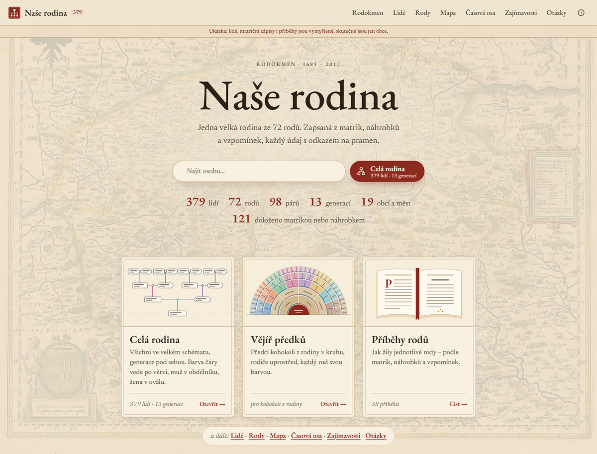
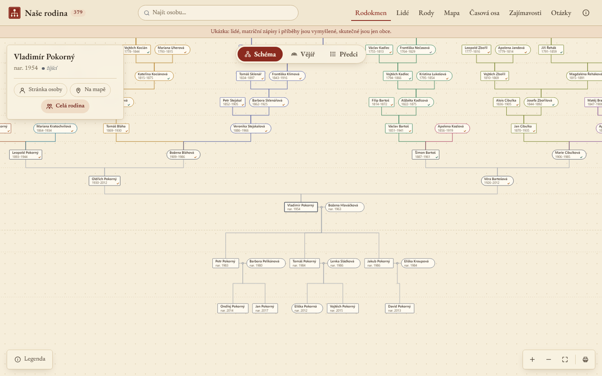
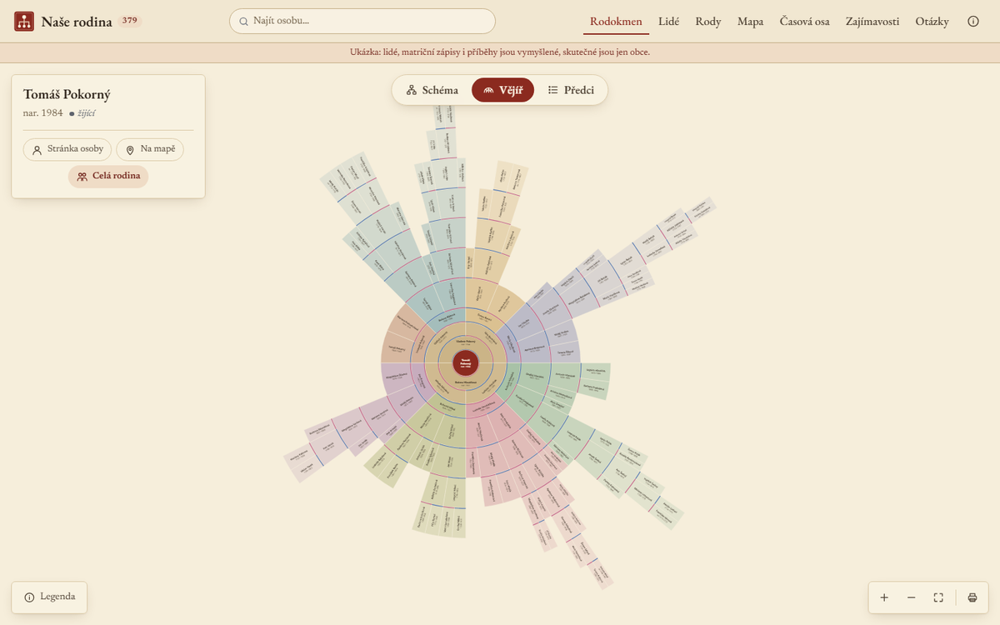
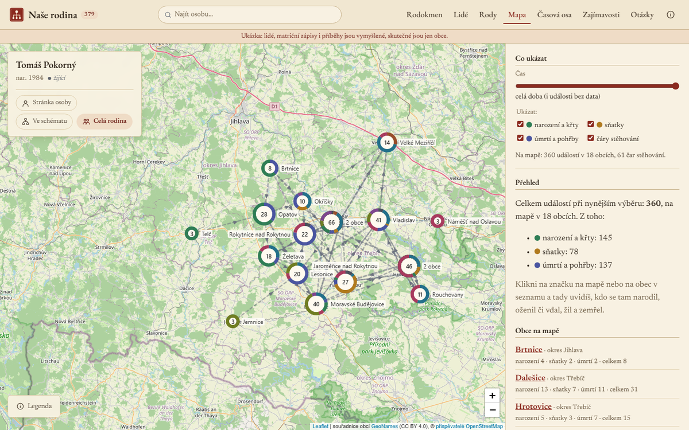
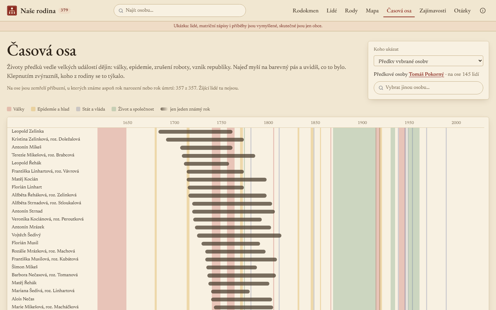
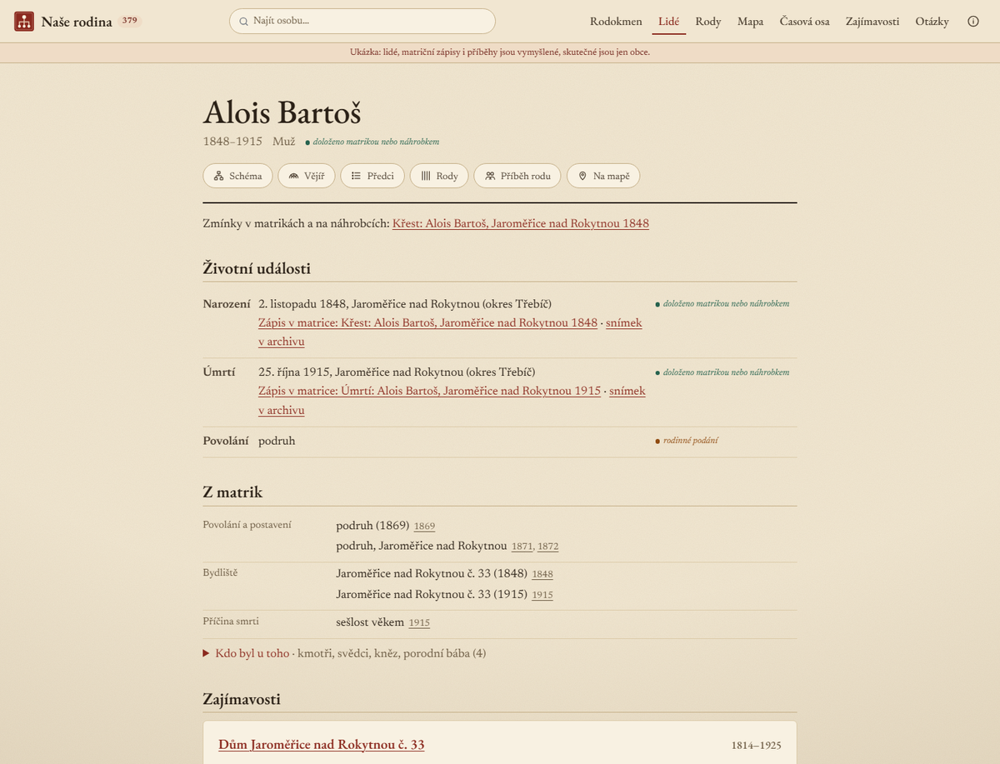
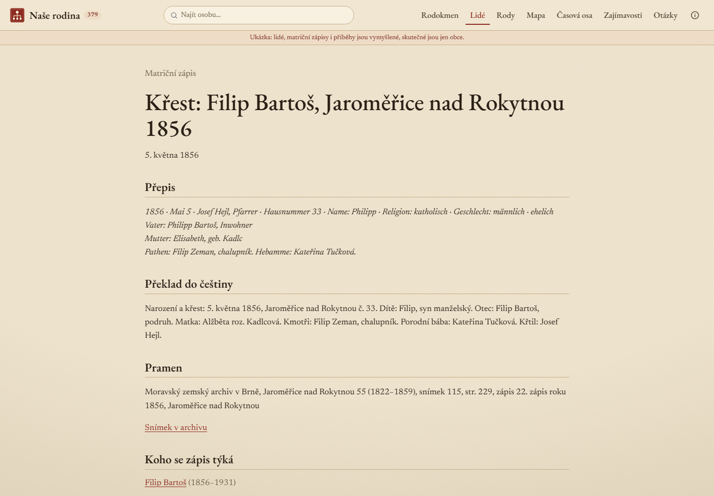
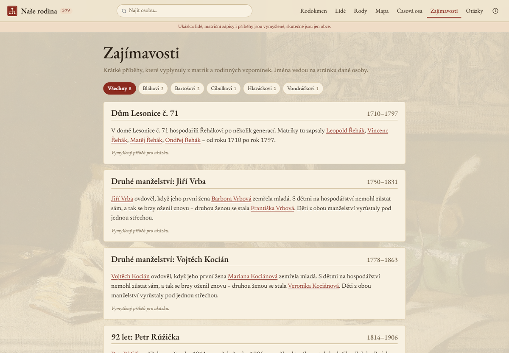

# Rodokmen

**A genealogy engine and family website for Czech and Moravian parish-register research.**

Every fact carries its evidence level and a citation down to the register image. The site shows the
family as an interactive chart, a fan of ancestors, a map, a timeline against history, and a page
for every person and every register entry. Living people are protected by a rule the build checks,
not a promise someone has to remember.

**[See the live demo →](https://rodokmen-demo.pages.dev)**

> The demo and the pictures show an **invented family**: 379 people across thirteen generations,
> about 600 register entries in Latin, German and Czech, gravestones, stories and open questions.
> Only the villages (Vysočina region) are real. The site's interface is in Czech.

## What it does

| | |
|---|---|
| **Evidence on every fact** | Five levels, from "read on the register image or a gravestone" down to "unknown". A person is as sure as the weakest fact that identifies them. |
| **Register entries** | Transcription in the original language, Czech translation, archive citation and a deep link to the scan. Scans themselves are never published. |
| **Family chart** | Ancestors above, descendants below, any person in the centre; zoom, pan, print. |
| **Fan of ancestors** | As many generations as the data reaches, each family line in its own colour. |
| **Map** | Births, marriages and deaths by village, with lines showing where people moved. |
| **Timeline** | Life bars of the ancestors over wars, epidemics and reforms of Czech history. |
| **Stories and lines** | Candidate stories are found in the data (long lives, large families, epidemics, one house over generations); each family line can carry its own story. |
| **Privacy** | Living people show only name and birth year; register text younger than the legal embargo stays out; nothing is published if anything leaks. |
| **Private by default** | The real family site sits behind a sign-in for the family only; nothing is indexed by search engines. |
| **Search and print** | Full-text search on every page; a printable one-sheet pedigree. |

## Pictures

| | |
|---|---|
|  |  |
| Family chart around one person | Fan of ancestors |
|  |  |
| Where the family lived | Lives against history |
|  |  |
| A person with sources and register details | A register entry: transcription and translation |
|  | |
| Stories found in the data | |

## Built with

A Python engine with a strict data model, consistency and privacy checks, and a static website
(Astro) with interactive views. No tracking; the map tiles are the only outside request.

## A family tree like this for your family?

Research in the parish registers and a website like the demo can be made to order.
Get in touch via **[svobodamartin.dev](https://svobodamartin.dev)**.

---

This repository is a showcase only; the source code is not public. © All rights reserved.
